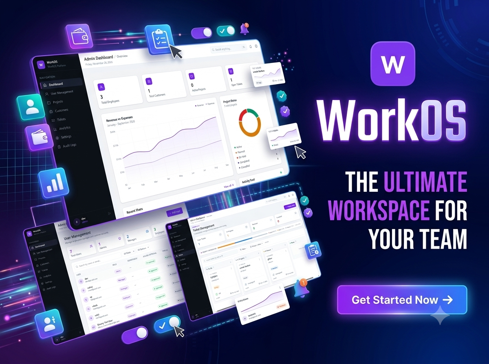

# Business Management System

WorkOS is a role based workspace for managing users, projects, and support tickets. The application has a React frontend and an Express API backed by MongoDB.

## Overview

The current application includes company registration, sign in and registration, role based access, admin user management, project management, ticket management, notifications, and dashboard pages. Some navigation destinations are still placeholders; see [Frontend status](#frontend-status).




## Features

- Register a company and its first admin account, or request access with a customer account.
- Sign in and sign out; protected API requests use a JWT in an HTTP only cookie or bearer authorization header.
- Admin user management: list company users, create managed users, edit user details and access status, and change roles.
- Company scoped projects: create and update projects, list projects by the signed in user's access, and manage project membership.
- Project tickets: create, list, update, and delete tickets with status, priority, assignee, and due date fields.
- Role specific dashboard APIs, status summaries, activity logs, and notifications.
- Role gated frontend navigation for admin, manager, employee, and customer accounts.

## Project layout

```text
Backend/                 Express API, MongoDB models, and controllers
BM_Frontend/BMS/         React and Vite frontend
```

## Requirements

- Node.js and npm
- MongoDB, local or hosted

## Run locally

### Backend

```bash
cd Backend
npm install
```

Create `Backend/.env`:

```env
PORT=4000
MONGODB_URL=mongodb://127.0.0.1:27017
DB_NAME=business_management
JWT_SECRET=replace_with_a_long_random_secret
NODE_ENV=development
```

`MONGODB_URL`, `DB_NAME`, and `JWT_SECRET` are required. The API joins the Mongo URL and database name. The frontend currently uses `http://localhost:4000/api`; local frontend origins are allowed by CORS.

Run the backend:

```bash
npm run dev
```

Use `npm start` for a regular Node.js start. `GET /` returns a service message.

### Frontend

In a second terminal:

```bash
cd BM_Frontend/BMS
npm install
npm run dev
```

Vite serves the app at `http://localhost:5173` by default.

## Frontend routes and status

- `/register`, `/login` — account entry.
- `/admin/dashboard`, `/admin/users`, `/admin/projects`, `/admin/tickets`, `/admin/api-docs` — implemented admin dashboard and management pages.
- `/manager/*`, `/employee/*`, `/customer/*` — role gated sections. Customer dashboard and ticket pages are implemented; several other destinations render an “under construction” placeholder.

## API reference

All routes below are mounted under `/api`. Send JSON request bodies where applicable. Protected routes require a valid login token; the admin routes require the admin role.

### Accounts, users, notifications, and company

| Method | Path | Access | Purpose |
| --- | --- | --- | --- |
| `POST` | `/api/company` | Public | Create a company and its initial admin. Requires `companyName`, `companyEmail`, `workspaceCode`, and `contactDetails` (`username`, `email`, `password`, `phone`, `address`, `city`, `state`, `country`). |
| `POST` | `/api/register` | Public | Request access with `username`, `email`, and `password`; public registration creates a customer account. |
| `POST` | `/api/login` | Public | Sign in with `email` and `password`. |
| `POST` | `/api/logout` | Public | Clear the login cookie. |
| `GET` | `/api/profile` | Authenticated | Get the signed in user's profile. |
| `GET` | `/api/users` | Admin | List users in the admin's company. |
| `POST` | `/api/users` | Admin | Create a company user. Body: `{"username":"Alex Doe","email":"alex@example.com","password":"ExamplePass123!","role":"employee"}`. Roles: `admin`, `manager`, `employee`, `customer`. Password must be 8–72 UTF-8 bytes. |
| `PATCH` | `/api/users/:userId` | Admin | Update any of `username`, `email`, `role`, and `accessStatus` (`pending`, `approved`, `rejected`). |
| `PATCH` | `/api/users/:userId/role` | Admin, manager | Change a user's role. Body: `{"role":"employee"}`. |
| `GET` | `/api/notifications` | Authenticated | Get notifications for the signed in user. |
| `PATCH` | `/api/notifications/read` | Authenticated | Mark notifications as read. |
| `GET` | `/api/getcompany/:adminId` | Admin | Get company information for an admin. |
| `POST` | `/api/approve/:userId` | Admin | Approve a user access request. |
| `POST` | `/api/reject/:userId` | Admin | Reject a user access request. |

### Dashboards and activity

| Method | Path | Access | Purpose |
| --- | --- | --- | --- |
| `GET` | `/api/admin` | Admin | Get admin dashboard data. |
| `GET` | `/api/status/card` | Admin | Get admin status cards. |
| `GET` | `/api/status/project` | Admin | Get project status summary. |
| `GET` | `/api/activity/logs` | Authenticated | Get activity log data. |
| `GET` | `/api/manager` | Admin, manager | Get manager dashboard data. |
| `GET` | `/api/employee` | Admin, manager, employee | Get employee dashboard data. |
| `GET` | `/api/customer` | Authenticated | Get customer dashboard data. |

### Projects

| Method | Path | Access | Purpose |
| --- | --- | --- | --- |
| `POST` | `/api/project` | Admin, manager | Create a project. Requires `name`, `manager`, `startDate`, and `dueDate`; accepts `description`, `status`, and `members`. |
| `PATCH` | `/api/project/:projectId` | Admin, manager | Update project fields. |
| `GET` | `/api/get/project` | Authenticated | List projects visible to the signed in user. |
| `GET` | `/api/employees` | Admin, manager, employee | List company employees. |
| `POST` | `/api/:projectId/members` | Authenticated | Add a project member; body: `{"employeeId":"<user-id>"}`. |

Project status values are `planned`, `active`, `on-hold`, `completed`, and `cancelled`. Due date must be on or after the start date.

### Tickets

| Method | Path | Access | Purpose |
| --- | --- | --- | --- |
| `POST` | `/api/ticket/:projectId` | Authenticated | Create a project ticket with `title` and `description`; optionally provide `assignedTo`, `priority`, and `dueDate`. |
| `GET` | `/api/tickets` | Authenticated | List tickets visible to the signed in user. |
| `POST` | `/api/update/ticket/:ticketId` | Authenticated | Update ticket fields such as `title`, `description`, `status`, `priority`, `assignedTo`, or `dueDate`. |
| `POST` | `/api/delete/ticket/:ticketId` | Authenticated | Delete a ticket, subject to controller access checks. |

Ticket statuses include `open`, `in_progress`, `in_review`, `resolved`, `closed`, and `escalated`. Priorities are `low`, `medium`, `high`, and `critical`. Controllers apply company, project, role, or assignment checks where implemented.

## Authentication and security notes

The API reads JWTs from the `token` cookie or the `Authorization: Bearer <token>` header. Login and company registration set an HTTP only `token` cookie. For production, use HTTPS and set `NODE_ENV=production` so the cookie is marked secure. Keep secrets in environment files and do not commit credentials.

## Frontend status

The admin dashboard includes a dashboard UI, user management, projects, tickets, and API documentation. The customer dashboard is implemented. Several manager, employee, and customer navigation pages are currently placeholders, and some admin navigation pages (customers, analytics, settings, audit logs) are placeholders. UI presence does not necessarily mean that a matching fully featured page or API is available.
